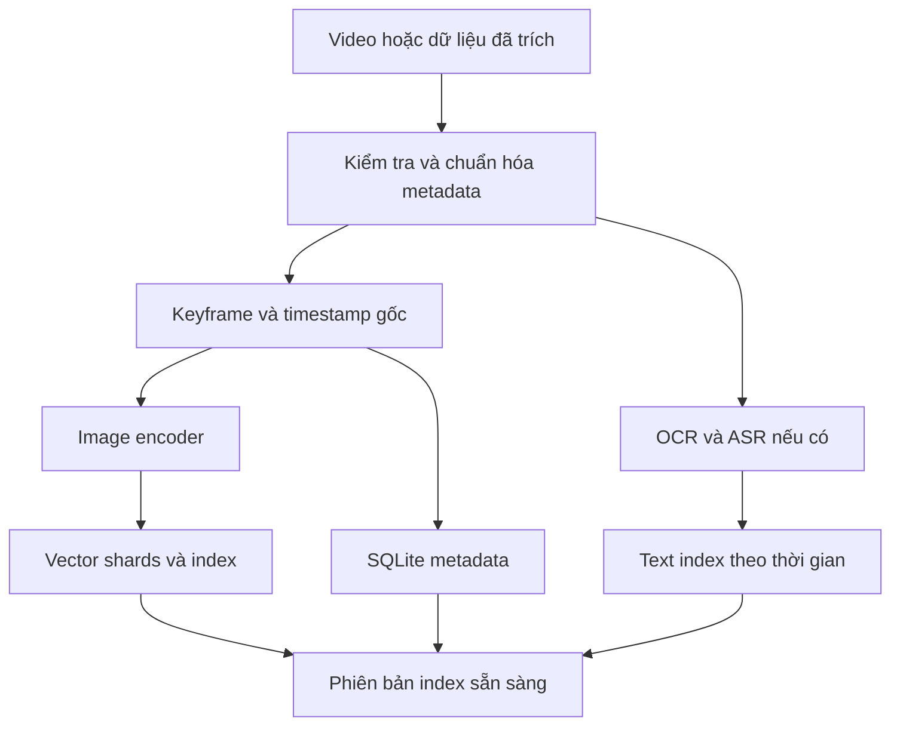
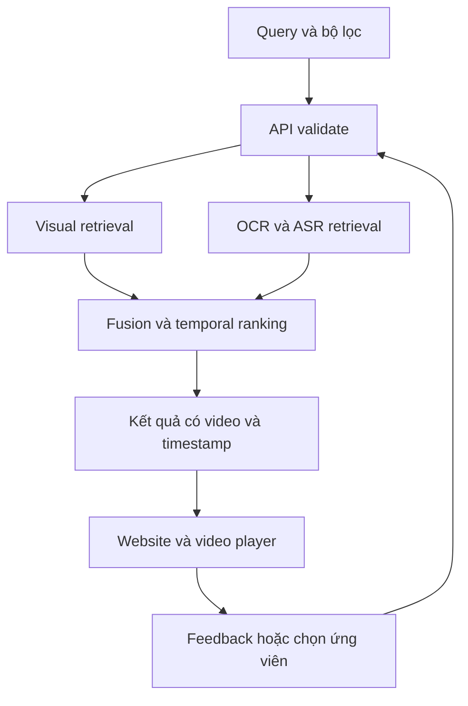
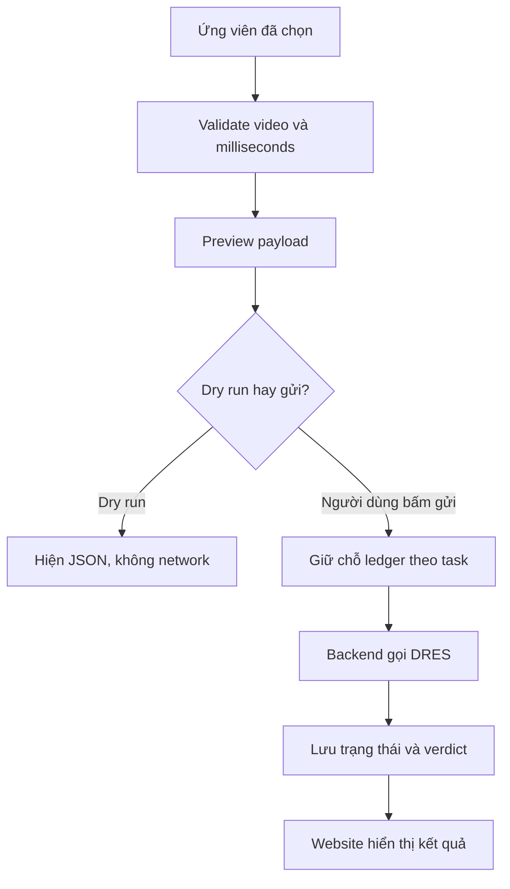

# Hướng dẫn hiểu và xây dựng hệ thống truy vấn video CS336

Dành cho Nguyễn Đức Nhật · Chuẩn bị ngày 14/10/2026

Tài liệu này giải thích thiết kế mà `PROMPT_CODEX_CS336.md` yêu cầu Codex triển khai: vì sao cần từng thành phần, dữ liệu đi qua đâu, website hoạt động thế nào, DRES chấm điểm ở đâu và cần kiểm tra điều gì. Đây là giáo trình trước khi triển khai, chưa phải báo cáo một hệ thống đã chạy. Các endpoint, đường dẫn code và lệnh `app.cli` dưới đây là hợp đồng dự kiến; Codex phải hiện thực rồi cập nhật chúng theo code cuối cùng.

Bạn có thể học ngay các phần nguyên lý. Những bài thực hành có câu lệnh của ứng dụng chỉ thực hiện sau khi Codex đã tạo dự án. Không dùng tài liệu này để khẳng định hệ thống đạt một mức Recall, tốc độ hay điểm thi cụ thể.

## 1. Bạn đang giải quyết bài toán gì

Giả sử có hàng nghìn video. Đề bài mô tả: “Một người mặc áo đỏ đứng bên xe buýt, sau đó đi vào cửa hàng.” Bạn cần tìm đúng video và thời điểm chứa sự kiện đó.

Đầu ra cần có tối thiểu:

```json
{
  "media_item_name": "EXAMPLE_VIDEO_001",
  "timestamp_ms": 12340
}
```

Tên video trong ví dụ là minh họa, chưa phải tên đã nhìn thấy trong dataset. `12340 ms` nghĩa là 12.34 giây trên video gốc. Đây mới là thông tin để phát đúng đoạn và chuẩn bị kết quả nộp; một câu trả lời như “có thể là video về giao thông” chưa giải quyết bài toán.

Hệ thống có ba phần công việc khác nhau:

| Phần | Khi nào chạy | Làm gì |
| --- | --- | --- |
| Chuẩn bị dữ liệu offline | Trước buổi tìm kiếm | Đọc video, lấy ảnh, tạo đặc trưng, lập chỉ mục |
| Truy vấn online | Khi bạn bấm Search | Biến yêu cầu thành đặc trưng, tìm và xếp hạng ứng viên |
| Tương tác và nộp kết quả | Sau khi bạn xem ứng viên | Xem đúng đoạn, sửa truy vấn, chọn đáp án, gửi DRES |

Không cần train model mới để bắt đầu. Model đã huấn luyện sẵn có thể biến ảnh và câu mô tả thành vector. Công việc quan trọng lúc đầu là lập chỉ mục đúng, giữ timestamp đúng và nối các phần thành một luồng chạy thật.

**Tự kiểm tra:** Video ở giây 12.34 có phải luôn là frame thứ 12 không? Không. Frame thứ bao nhiêu phụ thuộc tốc độ khung hình và cách đánh số; 12.34 là thời gian, không phải chỉ số frame.

**Tiến độ học:** Đã hiểu mục tiêu. Phần tiếp theo là kiểm kê dữ liệu thực tế của bạn.

## 2. Những gì đã biết và chưa biết về đầu vào

Thư mục [UIT trên Google Drive](https://drive.google.com/drive/folders/1LnPQDQ-IrG7qhIIlUSNtrygasznyKxsw) đã trả về hai archive:

| File | Byte nén | GB thập phân | GiB |
| --- | ---: | ---: | ---: |
| `bacth1.zip` | 66,931,894,376 | 66.93 | 62.34 |
| `batch2.zip` | 49,009,103,130 | 49.01 | 45.64 |
| Tổng | 115,940,997,506 | 115.94 | 107.98 |

Tên `bacth1.zip` đúng là viết như vậy trong kết quả đọc Drive. `GB` dùng cơ số 1000, `GiB` dùng cơ số 1024 nên con số khác nhau. Dung lượng trên là của ZIP; chưa biết dung lượng giải nén.

Chưa đọc phần bên trong ZIP, vì vậy chưa xác nhận:

- Có bao nhiêu video, ở thư mục nào, có trùng tên giữa hai batch không.
- Video dùng codec gì, dài bao lâu, CFR hay VFR, có audio không.
- Có keyframe, embedding, bản OCR/ASR, map frame–time hoặc nhãn đánh giá đi kèm không.

Drive giúp phân phối file. Nó không tự biến ZIP thành một ổ đĩa chứa video mà OpenCV đọc từng phần được ở mọi môi trường. Khả năng đọc một video nhỏ nằm bên trong ZIP từ xa phụ thuộc HTTP range, ZIP64 và cơ chế truy cập. Không nên mặc định rằng chỉ cần đưa folder URL vào code là truy vấn được cả kho.

Quy trình hợp lý:

1. Dùng dữ liệu đã có ở ổ đĩa nếu bạn đã tải trước.
2. Khi có ZIP local, đọc danh sách bên trong mà chưa giải nén toàn bộ.
3. Chọn vài video để chạy luồng hoàn chỉnh.
4. Đo dung lượng, thời gian và RAM thực tế rồi tăng quy mô.

Ví dụ dưới đây dùng thư viện chuẩn Python để xem một ZIP đã tải. Chạy trong PowerShell sau khi sửa đường dẫn, lệnh chỉ liệt kê, không giải nén:

```powershell
python -c 'from zipfile import ZipFile; from pathlib import Path; p=Path(r"D:\CS336\archives\bacth1.zip"); z=ZipFile(p); a=z.infolist(); print("entries:", len(a)); print("uncompressed bytes:", sum(x.file_size for x in a)); print("\n".join(x.filename for x in a[:30])); z.close()'
```

Nếu Python/PowerShell hiện tại xử lý dấu nháy khác, lưu đoạn Python vào một file `.py` rồi chạy file đó. Công cụ `inspect-data` của dự án phải cung cấp đường chạy dễ dùng hơn và xuất báo cáo có cấu trúc.

Khi giải nén, cần ngăn một entry kiểu `../../some-file` ghi ra ngoài thư mục đích. Kiểm tra dung lượng giải nén trước khi chạy. Tên file chỉ là metadata; không được thực thi script lạ có trong ZIP để “chuẩn bị dữ liệu”.

**Tự kiểm tra:** Hai ZIP tổng 115.94 GB có nghĩa ổ đĩa trống 120 GB là đủ cho cả dự án không? Không. Còn dữ liệu giải nén, ảnh, vector, index, model và file tạm; phải tính theo inventory thực tế.

**Tiến độ học:** Đã phân biệt nguồn dữ liệu và dữ liệu sẵn sàng truy vấn. Tiếp theo là kiến trúc tổng thể.

## 3. Bản đồ toàn bộ hệ thống

Luồng chuẩn bị dữ liệu:



Luồng khi tìm kiếm:



Các khối có trách nhiệm rõ ràng:

| Khối | Nhiệm vụ | Không nên làm thay |
| --- | --- | --- |
| Pipeline | Chuẩn bị dữ liệu có thể resume | Chạy lại toàn kho mỗi khi mở web |
| Encoder | Sinh vector từ ảnh/câu | Tự quyết đáp án thi đúng |
| Index | Tìm ứng viên nhanh | Tự phát video hoặc nộp bài |
| Backend | Điều phối, validate, mapping, DRES | Để trình duyệt đọc thẳng ổ D: |
| Website | Hiển thị, điều khiển, thu feedback | Giữ token DRES trong bundle |
| DRES | Nhận bài và đưa verdict theo cuộc thi | Trích keyframe hoặc train model |

Trong bản nhẹ, SQLite lưu metadata và lịch sử, còn vector nằm trong các shard NumPy. Một interface index cho phép chuyển sang FAISS hoặc Milvus mà không đổi schema kết quả. Không cần dựng một hệ thống phân tán chỉ để làm vài video đầu tiên.

**Tự kiểm tra:** Bạn đổi cách hiển thị lưới ảnh có phải encode lại cả dataset không? Không. Đó là thay đổi frontend; vector chỉ cần tạo lại khi đầu vào hoặc encoder/preprocessing liên quan thay đổi.

**Tiến độ học:** Đã nhìn thấy các thành phần. Tiếp theo học đơn vị dữ liệu mà chúng trao đổi.

## 4. Video, frame, keyframe, shot và event

| Khái niệm | Hiểu đơn giản | Ví dụ |
| --- | --- | --- |
| Video | File hình ảnh theo thời gian, thường có âm thanh | Một bản tin 20 phút |
| Frame | Một ảnh trong chuỗi hình | Ảnh được decoder đọc tại một thời điểm |
| Frame index | Chỉ số frame gốc theo quy ước | Frame 300, bắt đầu từ 0 |
| Keyframe | Ảnh được chọn làm đại diện để truy vấn | Một ảnh đại diện mỗi cảnh |
| Shot | Chuỗi hình liên tục giữa các lần cắt cảnh | Máy quay theo người đi bộ |
| Scene | Một cảnh có ngữ cảnh liên quan, có thể gồm nhiều shot | Toàn bộ phần phỏng vấn |
| Event | Sự kiện cần tìm, có thể kéo dài qua nhiều frame | Người lên xe buýt |

“Keyframe” trong pipeline truy vấn là ảnh đại diện được chọn; nó không nhất thiết là I-frame của codec. Một video có thể có hàng trăm nghìn frame nhưng chỉ lấy vài nghìn ảnh phục vụ tìm kiếm.

Chọn ảnh mỗi 2 giây dễ triển khai nhưng có thể bỏ qua sự kiện chỉ xuất hiện 0.3 giây. Chọn theo thay đổi cảnh giảm ảnh trùng, nhưng một cảnh gần như đứng yên vẫn có thể chứa thay đổi nhỏ quan trọng. Có thể kết hợp scene selection với khoảng cách tối đa giữa hai keyframe; chất lượng phải đo bằng tập truy vấn thật.

Một keyframe cần luôn giữ đường quay về nguồn:

```json
{
  "keyframe_id": "kf_example_000042",
  "video_uid": "vid_example_a",
  "media_item_name": "EXAMPLE_VIDEO_001",
  "original_frame_index": 300,
  "timestamp_ms": 12000,
  "timestamp_source": "verified_cfr_mapping",
  "thumbnail_relative_path": "thumbs/vid_example_a/000042.webp"
}
```

Trong ví dụ, ảnh đại diện thứ 42 có thể đến từ frame gốc 300. Không lấy số 42 để tính thời gian. `media_item_name` phục vụ giao tiếp tên media với DRES; `video_uid` là ID nội bộ có thể bao gồm namespace để chống trùng.

Nếu batch A và batch B đều chứa `sample.mp4`, không tự đổi tên gửi DRES thành `batchA_sample` khi server chỉ biết `sample`. Hệ thống phải phát hiện và yêu cầu mapping hợp lệ.

**Tự kiểm tra:** Tìm được ảnh đẹp, đúng nội dung nhưng mất video ID và timestamp thì có đủ để nộp KIS không? Chưa đủ; không xác định được chính xác media và vị trí cần gửi.

**Tiến độ học:** Đã hiểu đối tượng truy vấn. Tiếp theo là lỗi thường làm kết quả đúng hình nhưng sai thời điểm.

## 5. Timestamp và vì sao không được mặc định 25 FPS

FPS là frames per second, số khung hình mỗi giây. CFR nghĩa là tốc độ khung hình cố định; VFR nghĩa là tốc độ thay đổi theo thời gian. PTS là presentation timestamp, mốc dùng để trình chiếu một frame.

Với video CFR đã được xác minh, index gốc bắt đầu từ 0 và timeline đã quy về 0:

`timestamp_ms = round(frame_index × 1000 / fps)`

Ví dụ frame 300 của video 25 FPS:

`300 × 1000 / 25 = 12000 ms = 12 giây`.

Nếu video thực tế 30 FPS nhưng code lấy 25 FPS thì frame 300 bị hiểu thành 12 giây, trong khi phép đổi đúng là 10 giây. Sai 2 giây có thể đưa đến đoạn hoàn toàn khác.

Với FPS hữu tỉ `30000/1001`, giữ tử và mẫu thay vì làm tròn thành 30. Với VFR, dùng mốc PTS của frame hoặc map chính thức đã kiểm chứng. FPS trung bình không mô tả đầy đủ khoảng cách thời gian của từng frame.

Tất cả schema backend dùng `timestamp_ms: int`. Trình duyệt dùng `HTMLVideoElement.currentTime` theo giây nên chỉ ở ranh giới UI mới có:

```ts
// timestampMs là thời gian trên video gốc, không phải frame index.
videoElement.currentTime = timestampMs / 1000;
```

Nên chờ metadata player sẵn sàng trước seek. Nếu player đang dùng proxy có đoạn đầu bị cắt, timestamp của proxy phải được map lại về timeline gốc. Bản đầu có thể dùng video gốc để giảm rủi ro này.

Không được “chữa” thiếu map bằng FPS mặc định rồi gửi thi như thể đã chính xác. Nếu không đủ nguồn chứng minh, hiển thị cảnh báo và chặn thao tác submit phụ thuộc mốc đó.

**Tự kiểm tra:** Bạn trích 1 ảnh mỗi 2 giây rồi ảnh thứ 10 có chắc ở giây 20 không? Chỉ đúng nếu quy ước lấy mẫu, mốc bắt đầu và thứ tự đều như giả định. Cách an toàn là đọc timestamp đã ghi của ảnh đó.

**Tiến độ học:** Đã hiểu frame–time mapping. Tiếp theo là model và không gian vector.

## 6. Embedding và OpenCLIP hoạt động thế nào

Embedding là một dãy số biểu diễn nội dung. Hãy tạm tưởng tượng vector chỉ có ba số, dù model thực tế có thể xuất vài trăm hoặc hơn một nghìn chiều.

```text
Câu mô tả → text encoder → vector câu
Ảnh keyframe → image encoder → vector ảnh
```

Đây chỉ là ký hiệu ngắn cho hai phép biến đổi, không phải mô tả rằng model đã hiểu hoàn hảo mọi sự kiện. Một model tương thích kiểu CLIP được huấn luyện để vector của ảnh và mô tả phù hợp gần nhau trong cùng không gian.

Ba điểm dễ nhầm:

1. Không thể lấy text vector từ một model bất kỳ rồi so với image vector từ model khác chỉ vì cùng số chiều.
2. Cùng kiến trúc nhưng khác checkpoint hoặc preprocessing vẫn có thể làm vector không tương thích.
3. CLIP ảnh–text trên keyframe không tự mô hình hóa chuyển động qua toàn bộ clip; truy vấn hành động và quan hệ trước/sau cần các bước khác.

Trong thiết kế nhẹ, cặp `ViT-B-32` và `laion2b_s34b_b79k` là một lựa chọn khởi đầu đã có ví dụ trong tài liệu OpenCLIP. Codex phải xác nhận cặp này tồn tại trong phiên bản dùng, đo tài nguyên và khóa phiên bản; không coi đó là lựa chọn tốt nhất cho mọi bộ dữ liệu. Baseline dùng model lớn hơn nên không nên bê nguyên cấu hình đó lên GPU 6 GB mà chưa kiểm tra.

Khi inference:

- `model.eval()` đặt chế độ suy luận thích hợp.
- `no_grad()` hoặc `inference_mode()` giảm việc lưu trạng thái phục vụ tính gradient.
- Batch nhỏ giới hạn VRAM, đổi lại có thể giảm tốc độ.
- Image preprocessing và tokenizer phải đúng model.
- Lưu encoder ID/checkpoint, dimension thực tế, preprocessing, normalization vào manifest.

Nếu đổi encoder, pipeline phải tạo lại embedding liên quan và index. Đổi tên file cấu hình không biến những vector cũ thành vector của model mới.

### Cosine similarity qua ví dụ

Cosine đo độ cùng hướng của hai vector:

`cos(a,b) = dot(a,b) / (norm(a) × norm(b))`.

Với `a=[3,4]`, `b=[0,5]`: tích vô hướng bằng 20, hai độ dài đều bằng 5, cosine bằng `20/25=0.8`. Sau chuẩn hóa L2, vector có norm bằng 1; lúc đó inner product bằng cosine. Muốn dùng index inner product như cosine thì phải chuẩn hóa cả vector dữ liệu và query.

Cosine 0.8 không có nghĩa đáp án đúng với xác suất 80%. Nó chỉ là điểm giống nhau theo biểu diễn đó. Ngay cả kết quả đứng đầu cũng có thể sai nếu mô tả mơ hồ hoặc thiếu cảnh trong index.

### Tiếng Việt

Không mặc định một checkpoint CLIP thiên về tiếng Anh tìm tiếng Việt tốt. Một đường chạy dễ giải thích là dùng câu tiếng Việt cho OCR/ASR, thêm ô mô tả tiếng Anh cho kênh visual. Có thể bổ sung model đa ngôn ngữ hoặc translator sau, nhưng phải kiểm tra đúng cặp encoder và dữ liệu, giữ bản dịch để người dùng kiểm chứng.

**Tự kiểm tra:** Hai vector đều có 512 chiều có chắc so sánh được không? Không. Chúng còn phải thuộc cùng không gian biểu diễn tương thích.

**Tiến độ học:** Đã hiểu đặc trưng và điểm giống nhau. Tiếp theo là tìm nhanh trong kho vector.

## 7. Index và metadata

Nếu có một triệu keyframe, mỗi query so với cả một triệu vector là exact search. Nó dễ kiểm chứng nhưng tốn thời gian và băng thông bộ nhớ. Một index ANN chấp nhận khả năng bỏ lỡ một số hàng xóm để tìm nhanh hơn; cần đo tradeoff tốc độ và chất lượng.

| Lựa chọn | Phù hợp khi | Điều phải lưu ý |
| --- | --- | --- |
| NumPy exact search theo block | Tập mẫu, baseline đúng, Windows nhẹ | CPU/RAM và thời gian tăng theo số vector |
| FAISS CPU | Muốn có exact/ANN và profile tối ưu | Kiểm tra bản cài và loại index trên môi trường thật |
| Milvus | Có hạ tầng vector database và cần service riêng | Vận hành, schema, index/metric, RAM, kết nối |

SQLite trả lời câu hỏi “ID này là video nào, timestamp nào, thumbnail ở đâu?”. Index vector trả lời “những ID nào có biểu diễn gần query?”. Chúng bổ sung cho nhau.

Một hàng vector cần mapping ổn định:

| Row trong shard/index | Keyframe ID | Video | Timestamp |
| ---: | --- | --- | ---: |
| 0 | `kf_a` | `vid_a` | 1000 ms |
| 1 | `kf_b` | `vid_b` | 5500 ms |
| 2 | `kf_c` | `vid_a` | 3000 ms |

Nếu quá trình lưu làm đổi thứ tự vector mà mapping không đổi, ảnh và video trả về sẽ sai dù phép tìm vector đúng. Đây là lý do phải kiểm tra save/load và row-ID mapping.

### Ước lượng tài nguyên

Vector float32 chiếm gần `N × D × 4 byte` trước overhead. Ví dụ giả định `N=1,000,000`, `D=512` thì dữ liệu vector thô khoảng 2.048 GB thập phân, chưa tính index, metadata, thumbnail, bản sao khi build và bộ nhớ model. Đây là phép tính minh họa, chưa phải số lượng keyframe của dataset bạn.

Không cần nhét cả index vào VRAM. GPU có thể encode query/frame, CPU hoặc service riêng tìm vector. Với RAM hạn chế, đọc theo shard/block thay vì materialize toàn bộ ma trận cùng lúc.

### Manifest và publish

Manifest ghi nguồn vector và phiên bản. Một index build dở chưa được website coi là ready. Cần build ở staging, kiểm tra số hàng, dimension, ID và shard, rồi publish phiên bản mới nguyên tử. Query và cache gắn với `index_version` để tránh trộn kết quả cũ.

**Tự kiểm tra:** Bạn thay model mà giữ nguyên vector cũ, API vẫn không crash thì hệ thống đã đúng chưa? Chưa. Nó có thể chạy nhưng so sánh sai không gian, làm chất lượng sai một cách khó thấy.

**Tiến độ học:** Đã hiểu vector index. Tiếp theo là thông tin chữ và âm thanh.

## 8. OCR, ASR và truy vấn văn bản truyền thống

OCR là Optical Character Recognition: đọc chữ trong hình, như bảng hiệu hoặc số trên màn hình. ASR là Automatic Speech Recognition: nhận dạng tiếng nói thành văn bản. Hai nguồn này trả lời các loại yêu cầu mà hình ảnh tổng thể thường khó phân biệt.

Ví dụ “người đứng cạnh bảng có chữ Tuyển sinh 2026” có thể tìm bằng visual để lấy bối cảnh, đồng thời OCR tìm chính xác chữ. Yêu cầu “người phát biểu nhắc đến học bổng” có thể được ASR hỗ trợ.

Giữ kết quả theo thời gian:

```json
{
  "segment_id": "asr_example_01",
  "video_uid": "vid_example_a",
  "start_ms": 10000,
  "end_ms": 14000,
  "source": "asr",
  "text_original": "Chương trình học bổng năm nay..."
}
```

Nếu câu này match, hệ thống biết cần kiểm tra khoảng 10–14 giây. Không gắn cùng một câu transcript cho mọi frame trong video. Với OCR chỉ quan sát ở một frame, lưu thời điểm quan sát; không tự khẳng định chữ tồn tại suốt một đoạn dài.

### Term và inverted index

Term là đơn vị từ khóa dùng trong index. Inverted index ánh xạ một term đến các tài liệu hoặc segment chứa nó. Với `học_bổng → {segment 4, segment 19}`, tìm keyword không cần quét lại mọi câu.

Tokenization, chuẩn hóa Unicode, lowercasing và quy tắc dấu phải nhất quán giữa ingest và query. Bỏ hết dấu tiếng Việt có thể tăng recall nhưng gây nhầm từ; nên giữ text gốc và đánh giá phiên bản chuẩn hóa. Không áp dụng stemming tiếng Anh tùy tiện cho tiếng Việt.

### Boolean Retrieval Model

- `A AND B`: yêu cầu đồng thời A và B.
- `A OR B`: chấp nhận A hoặc B.
- `A AND NOT B`: có A và loại B theo phạm vi tìm đã định nghĩa.

Boolean “có/không” không tự xếp thứ hạng theo mức độ phù hợp. Parser cần grammar và ưu tiên toán tử rõ ràng, không dùng Python `eval` để chạy câu người dùng nhập.

### Vector Space Model với TF-IDF

TF phản ánh tần suất term trong tài liệu. IDF tăng trọng số các term hiếm trong corpus. Văn bản và query trở thành vector term, rồi có thể so cosine. Công thức TF/IDF có nhiều biến thể; dự án phải công bố biến thể đang dùng.

BM25 là phương pháp xếp hạng text phổ biến khác, có bão hòa tần suất từ và xử lý độ dài tài liệu. Nếu dùng SQLite FTS, phải ghi rõ hàm ranking thực tế và hướng tốt/xấu của score; không giả định mọi thư viện trả điểm lớn hơn là tốt hơn.

### Khi nào chạy model OCR/ASR

Ưu tiên import kết quả sẵn có nếu xác minh được nguồn và timestamp. Nếu thiếu, chạy bộ trích thực, chọn model hỗ trợ ngôn ngữ và môi trường. OCR và ASR có thể chạy thành job riêng; không bắt chúng chạy lại mỗi lần Search. Máy 6 GB có thể chạy tuần tự các job thay vì giữ mọi model trong VRAM cùng lúc.

**Tự kiểm tra:** OCR nhận sai “2026” thành “2028” thì một exact keyword query có thể bỏ lỡ kết quả không? Có. Cần xem text gốc, kiểm chứng trên frame và phân tích lỗi; semantic image retrieval có thể là một đường hỗ trợ.

**Tiến độ học:** Đã có nhiều kênh truy vấn. Tiếp theo là cách kết hợp chúng.

## 9. Hybrid search và temporal search

### Kết hợp nhiều kênh bằng rank fusion

Visual retrieval có cosine, text retrieval có BM25 hoặc score FTS. Các điểm này không cùng thang đo. Cộng trực tiếp có thể để một kênh lấn át chỉ vì con số của nó lớn hơn.

Reciprocal Rank Fusion dùng vị trí thứ hạng thay vì giá trị score thô:

`RRF(item) = Σ channel_weight / (k0 + rank_in_channel)`.

Rank bắt đầu từ 1; item không có trong một danh sách không nhận đóng góp từ danh sách đó. `k0` là tham số cần công khai, không phải số kết quả trả về. Ví dụ minh họa dùng `k0=60`, hai kênh trọng số 1:

| Ứng viên | Rank visual | Rank OCR | RRF xấp xỉ |
| --- | ---: | ---: | ---: |
| A | 1 | 3 | 0.032266 |
| B | 2 | 1 | 0.032522 |

B nhỉnh hơn trong ví dụ này. Điểm đó không phải xác suất đúng. Các candidate phải được map về cùng đơn vị, ví dụ keyframe/event anchor; không cộng rank của một video với rank của một đoạn transcript khác cấp mà không có quy tắc mapping.

Nếu OCR unavailable, hệ thống không nên giả lập điểm OCR. Nó trả capability và warnings để UI biết đang tìm bằng những kênh nào. Khi so benchmark, ghi rõ kênh hoạt động.

### Truy vấn A rồi B

Yêu cầu “người đứng cạnh xe, sau đó vào cửa hàng” có hai sự kiện. Đầu tiên lấy candidate A và candidate B. Chỉ ghép khi:

`same_video AND min_gap_ms <= tB - tA <= max_gap_ms`, đồng thời thứ tự sau phải thực sự dương nếu quy định A rồi B.

Ví dụ A ở 12 giây, B ở 16 giây cùng video, max gap 10 giây → hợp lệ. A ở video X và B ở video Y → không hợp lệ. B ở 9 giây trong khi A ở 12 giây → sai thứ tự.

Phải trả cả hai mốc và cách tính rank. Website có thể cho xem A rồi B để người dùng kiểm tra. Không dùng một ngưỡng “1500 frame” cho mọi FPS; dùng milliseconds. Không so mọi cặp frame trên toàn kho thành một ma trận cực lớn; nhóm theo video và giới hạn candidate/window.

### Lọc và đa dạng kết quả

Các filter có thể giới hạn batch, video hoặc thời gian. Filter phải thực sự đi vào engine, không chỉ là dropdown trên UI. Sau khi đa dạng hoặc nhóm video, cần lưu trạng thái để benchmark có thể tái hiện cùng ranking; việc hiển thị gọn không nên âm thầm đổi phương pháp đánh giá.

**Tự kiểm tra:** Hai cảnh giống mô tả nhưng ở hai video khác nhau có chứng minh được “A rồi B” trong cùng sự kiện không? Không. Tương quan thời gian cần cùng media và mốc hợp lệ.

**Tiến độ học:** Đã hiểu hợp nhất và thứ tự thời gian. Tiếp theo là vai trò phản hồi của người dùng.

## 10. Relevance Feedback, Query Expansion và rerank

Relevance là mức liên quan của một kết quả đối với câu hỏi. Bạn đánh dấu một vài ảnh đúng/sai để hệ thống điều chỉnh cách tìm. Đây là tương tác retrieval, chưa phải huấn luyện lại trọng số encoder.

Một dạng Rocchio đơn giản:

`q_new = α × q + β × mean(relevant_vectors) - γ × mean(irrelevant_vectors)`.

Các vector phải cùng không gian. Sau cập nhật có thể normalize lại trước khi search. Nếu chưa có relevant hoặc irrelevant, bỏ phần tương ứng theo quy tắc đã định, tránh chia cho 0. Có reset để quay lại query ban đầu và giữ feedback theo phiên tìm.

Query Expansion thêm thuật ngữ hỗ trợ, ví dụ “xe buýt” và “bus”. Việc mở rộng có thể giúp hoặc làm query lệch ý. Website nên hiện từ được thêm, cho sửa/tắt và lưu cấu hình để đánh giá.

Rerank là xếp lại một tập ứng viên đã lấy được. Một reranker đắt thường chỉ chạy trên top nhỏ. Không nên dùng model lớn để che một index/map đang sai. Bản đầu cần một baseline dễ giải thích rồi mới đánh giá cải tiến.

**Tự kiểm tra:** Bấm “liên quan” có khiến model CLIP học lại ngay không? Không trong thiết kế này. Hệ thống lưu feedback và thay vector/query/ranking; trọng số encoder vẫn giữ nguyên.

**Tiến độ học:** Đã hiểu phần tương tác thông minh. Tiếp theo là backend điều phối các bước này.

## 11. Backend từ request đến response

Frontend gửi request HTTP đến FastAPI. Backend validate dữ liệu, kiểm tra index và capability, chạy retrieval, ghép metadata rồi trả JSON. Một query text dự kiến:

```json
{
  "query": "người áo đỏ cạnh xe buýt",
  "visual_query": "a person in a red shirt next to a bus",
  "mode": "hybrid",
  "top_k": 30,
  "filters": {"source_batches": []}
}
```

Đây là ví dụ contract cần Codex thống nhất trong OpenAPI, chưa phải payload bảo đảm tồn tại ở baseline hiện tại. Response nên đủ dữ liệu để UI không đoán:

```json
{
  "query_id": "q_example_01",
  "index_version": "example_index_v1",
  "timing_ms": {"encode": 0, "search": 0, "total": 0},
  "warnings": ["Ví dụ schema, chưa phải số đo thực tế"],
  "results": [
    {
      "rank": 1,
      "keyframe_id": "kf_example_000042",
      "video_uid": "vid_example_a",
      "media_item_name": "EXAMPLE_VIDEO_001",
      "timestamp_ms": 12000,
      "thumbnail_url": "/api/thumbnails/kf_example_000042",
      "score_type": "rrf",
      "channel_evidence": {"visual_rank": 1, "ocr_rank": 3}
    }
  ]
}
```

Các số 0 trong timing chỉ minh họa schema; không được đưa nguyên vào dashboard như kết quả đo. Response thực phải điền số đo thực.

### Cấu trúc code dự kiến

| Vùng | Chứa gì | Câu hỏi khi đọc code |
| --- | --- | --- |
| `app/api/` | Route và request/response schema | Nhận/validate cái gì? |
| `app/services/` | Điều phối search, feedback, submit | Thứ tự các bước và lỗi? |
| `app/retrieval/` | Vector/text search, fusion, temporal | Thuật toán, score, filter? |
| `app/data/` | Metadata, import, timestamp, manifest | ID và thời gian từ đâu? |
| `app/pipeline/` | Extract, encode, index jobs | Resume và memory giới hạn thế nào? |
| `app/integrations/dres/` | Client, profile, payload, ledger | Khi nào có network write? |
| `frontend/src/` | Component, API client, state | Query cũ/mới và player có đồng bộ không? |

Tên thực tế có thể khác. Giáo trình cuối cùng do Codex tạo phải dùng file/hàm thật của dự án thay vì giữ bảng dự kiến này.

### Những chi tiết ảnh hưởng độ đúng

- Không nạp model nhiều lần theo mỗi request.
- Không tải weights như tác dụng phụ của việc chỉ import module để chạy test.
- Không để encode/extract nặng chặn event loop của API.
- Không trả SDK object trực tiếp; chuẩn hóa về schema JSON.
- Không báo healthy/readiness nếu model hoặc index cần thiết chưa sẵn sàng.
- Lỗi video thiếu, index chưa publish, query rỗng và mode chưa có dữ liệu cần thông báo khác nhau.
- Cache phải tính đến model/index/filters/feedback; nếu chỉ dùng câu query làm key sẽ có thể trả kết quả sai phiên bản.

**Tự kiểm tra:** API trả HTTP 200 nhưng chỉ trả một result trong khi yêu cầu top 30 thì UI có tự sửa được không? Không. Contract/backend cần được kiểm tra; frontend không thể tạo thêm kết quả đúng từ dữ liệu không có.

**Tiến độ học:** Đã hiểu service phía server. Tiếp theo là website phía trình duyệt.

## 12. Website và state khi người dùng thao tác

Website là công cụ làm việc: bạn nhập mô tả, lướt ảnh, xem đoạn liên quan và nộp có kiểm tra. Một màn hình tìm kiếm nên dành phần lớn diện tích cho keyframe và player.

| Thành phần dự kiến | State chính | Sự kiện |
| --- | --- | --- |
| SearchBar | Query, mode, filters | Search, Enter, đổi mode |
| ResultGrid | Results, loading, selected ID | Chọn ảnh, chuyển trang |
| VideoPanel | Video UID, current time, media state | Load metadata, seek, play |
| Filmstrip | Danh sách frame và timestamp | Chọn frame trước/sau |
| FeedbackPanel | Relevant/irrelevant IDs | Đánh dấu, reset, tìm lại |
| SubmissionPanel | Task/evaluation, candidate, QA answer | Preview, gửi chủ ý |
| History | Query/submission records | Mở lại, xem lỗi/verdict |

### Một lượt Search hoàn chỉnh

1. Validate query không rỗng, mode đang khả dụng.
2. Gửi request và hiện loading.
3. Hủy request cũ hoặc dùng request ID để bỏ response cũ khi người dùng đã tìm câu mới.
4. Nhận results, hiện grid và warnings.
5. Chọn ảnh → tải metadata/video → seek bằng `timestamp_ms / 1000` sau khi player ready.
6. Hiện filmstrip lân cận và đánh dấu ảnh đang chọn.
7. Chọn ứng viên hoặc feedback; mỗi hành động có state riêng.

Không dùng cùng một biến `timestamp` lúc thì frame index, lúc thì giây, lúc thì milliseconds. Tên rõ như `timestampMs`, `currentTimeSeconds`, `originalFrameIndex` giúp hạn chế lỗi.

### Vì sao video cần HTTP byte ranges

Trình duyệt thường yêu cầu một khoảng byte để xem/seek. Backend cần trả `206 Partial Content`, `Content-Range` và độ dài đúng; range không hợp lệ trả `416`. Hỗ trợ tải từng đoạn giúp người dùng không phải chờ nhận toàn bộ video trước mọi thao tác. MP4 codec không được trình duyệt hỗ trợ có thể cần proxy/transcode, nhưng vẫn phải giữ mapping về video gốc.

### Trải nghiệm cần có

Loading, không có kết quả, thiếu channel, lỗi network và chưa có index là các tình huống khác nhau. Cần lazy thumbnail/virtualization khi nhiều ảnh, phím Enter/focus rõ và tên nút đọc được. Token DRES không nằm trong localStorage hay link URL của trang.

**Tự kiểm tra:** Query B trả về trước query A; nếu A về trễ mà UI vẫn thay grid bằng A thì lỗi nằm ở đâu? Quản lý request/state phía frontend cần chống response cũ ghi đè kết quả mới.

**Tiến độ học:** Đã hiểu luồng tìm và xem. Tiếp theo là gửi kết quả qua hệ thống chấm điểm.

## 13. DRES là nơi nhận bài, không nằm trong model

Distributed Retrieval Evaluation Server là hệ thống server phục vụ đánh giá truy vấn tương tác. Ứng dụng của bạn gửi câu trả lời theo hợp đồng của cuộc thi; server đưa verdict theo dữ liệu và cấu hình của họ.

Luồng tách riêng:



### Profile AIC2024 và giới hạn áp dụng

Tài liệu DOCX bạn cung cấp nói về vòng chung kết năm 2024. Cấu trúc nộp là nguồn để làm profile `aic2024_v2`. Không suy ra rằng URL, tài khoản, thời gian thi thử hoặc luật đó vẫn áp dụng cho lớp hiện tại.

Địa chỉ `https://eventretrieval.one` trong DOCX là endpoint lịch sử. Trước live integration, cần base URL và thông tin truy cập do giảng viên/BTC cấp cho đúng đợt. Không cần tự dựng DRES để bắt đầu viết client; mock cục bộ đủ để kiểm tra contract trước.

### Ba bước giao tiếp trong tài liệu

| Bước | Giao tiếp DRES v2 | Kết quả cần giữ |
| --- | --- | --- |
| Đăng nhập | `POST /api/v2/login` với username/password | `sessionId` ở backend |
| Chọn evaluation | `GET /api/v2/client/evaluation/list`, query param `session` | Evaluation đang thi phù hợp |
| Nộp bài | `POST /api/v2/submit/{evaluationID}`, query param `session` | Response/verdict được kiểm tra |

Session xác định phiên/tài khoản của đội; evaluation là một cuộc đánh giá; task là câu hỏi/round cụ thể bên trong evaluation. Ba thứ này khác nhau. Có nhiều evaluation ACTIVE thì cần chọn đúng, không tự lấy phần tử đầu.

Tài liệu hướng dẫn xem query hiện tại trên web DRES. Nếu phiên bản server hỗ trợ task endpoint, client có thể dùng nó sau khi đối chiếu schema; nếu không thì UI phải có task key nhập tay rõ ràng. Không tự bịa một endpoint với hy vọng server nào cũng có.

### Payload KIS

Known-Item Search là tìm đúng một mục/đoạn đã được mô tả. Với point submission ở profile tài liệu, thời điểm đầu và cuối bằng nhau:

```json
{
  "answerSets": [
    {
      "answers": [
        {"mediaItemName": "EXAMPLE_VIDEO_001", "start": 12340, "end": 12340}
      ]
    }
  ]
}
```

`mediaItemName` là tên file không có đuôi, không phải đường dẫn ổ D:, video UID nội bộ hoặc tên ảnh keyframe. `start` và `end` là milliseconds trên video gốc. Không gửi `12.34` khi định gửi 12.34 giây.

### Payload QA

Theo DOCX, đáp án QA chỉ gồm các chữ số `0` đến `9`, format text nộp là:

`<ANSWER>-<VIDEO_ID>-<TIME(ms)>`.

```json
{
  "answerSets": [
    {
      "answers": [
        {"text": "007-EXAMPLE_VIDEO_001-12340"}
      ]
    }
  ]
}
```

`007` phải là chuỗi, không parse qua integer thành `7`. Không thêm `QA-` và không ghép cả câu hỏi vào vị trí đáp án. Q&A ở đây không bắt buộc hệ thống dùng một VLM lớn tự suy luận; người dùng có thể đọc evidence và nhập đáp án được kiểm chứng.

### Ví dụ code dựng payload

Đoạn Python sau chỉ tạo JSON trong bộ nhớ, không gửi network. Dự án thực cần bổ sung validator mapping video, duration và task/profile ở lớp service.

```python
import re
from typing import Any


def build_aic2024_payload(
    media_item_name: str,
    timestamp_ms: int,
    answer: str | None = None,
) -> dict[str, Any]:
    """Dựng payload KIS hoặc QA theo profile AIC2024.

    Args:
        media_item_name: Tên media đã được xác thực, không có phần đuôi.
        timestamp_ms: Thời điểm nguyên trên timeline video gốc, đơn vị ms.
        answer: None cho KIS; chuỗi ASCII digits cho QA, giữ số 0 đầu.

    Returns:
        JSON-compatible dictionary; không chứa token DRES.

    Raises:
        ValueError: Tên rỗng, timestamp sai kiểu/âm hoặc đáp án sai format.
    """
    if not media_item_name or media_item_name != media_item_name.strip():
        raise ValueError("Media name phải là tên đã chuẩn hóa, không rỗng.")
    # bool kế thừa int trong Python nên kiểm tra kiểu chính xác ở ranh giới này.
    if type(timestamp_ms) is not int or timestamp_ms < 0:
        raise ValueError("timestamp_ms phải là integer không âm.")

    if answer is None:
        item: dict[str, Any] = {
            "mediaItemName": media_item_name,
            "start": timestamp_ms,
            "end": timestamp_ms,
        }
    else:
        # Không dùng isdigit(): profile yêu cầu đúng ký tự ASCII 0–9.
        if not isinstance(answer, str) or re.fullmatch(r"[0-9]+", answer) is None:
            raise ValueError("QA cần một chuỗi không rỗng chỉ chứa 0–9.")
        item = {"text": f"{answer}-{media_item_name}-{timestamp_ms}"}

    return {"answerSets": [{"answers": [item]}]}
```

### Ledger và lỗi gửi trùng

DOCX nói không nộp trùng kết quả cho cùng query. Chỉ disable nút ở frontend chưa đủ: hai tab hoặc hai request vẫn có thể gửi đồng thời. Backend cần tạo một reservation có unique constraint theo evaluation, task key và payload canonical trước khi gọi network.

Vòng đời nên phân biệt:

| Trạng thái | Ý nghĩa |
| --- | --- |
| `dry_run` | Chỉ dựng payload, không gửi |
| `sending` | Đã giữ chỗ và đang gọi server |
| `accepted_pending` | Server nhận nhưng chưa có verdict cuối |
| `correct` / `incorrect` | Verdict của câu trả lời đã được xác nhận |
| `rejected` | Server từ chối request hoặc điều kiện nộp |
| `unknown` | Không xác định được server đã nhận hay chưa |

Timeout không có nghĩa server chưa nhận. Tự retry POST có thể gửi trùng hoặc làm tăng lần sai; trạng thái unknown cần đối chiếu. HTTP 200/202 không tự chứng minh câu trả lời đúng. Adapter phải parse verdict theo schema server thực tế, không chỉ kiểm tra mã HTTP.

Dry run/mock/live cần namespace riêng để một lần thử không vô tình khóa bài thật. Sang task mới có thể nộp cùng media/timestamp nếu đó là đáp án của câu mới, nên chống trùng không được chỉ dựa vào video và thời gian toàn cuộc thi.

### Luật Video KIS

Tài liệu AIC2024 quy định không chụp/ghi lại clip đề Video KIS để đưa vào công cụ. Vì vậy khi dùng profile thi tương ứng, website và API phải chặn đường đưa ảnh/clip đề vào tìm image và hướng dẫn diễn tả bằng text. Chỉ ẩn nút frontend chưa đủ để bảo đảm đường xử lý bị chặn.

Chế độ image retrieval vẫn hữu ích cho nghiên cứu, dữ liệu do người dùng sở hữu hoặc buổi luyện tập có cho phép. Phải phân biệt rõ ngữ cảnh và áp dụng luật đúng đợt hiện tại.

**Tự kiểm tra:** DRES trả “đã nhận” có đồng nghĩa bạn được 100 điểm không? Không. Cần verdict đúng, thời gian và số lần sai theo cấu hình đánh giá.

**Tiến độ học:** Đã hiểu client chấm điểm. Tiếp theo phân biệt điểm tương tác với metric chất lượng retrieval.

## 14. Công thức điểm AIC2024 và hai loại thời gian

Ảnh công thức trong DOCX cho:

`score = max(0, 50 + 50 × (1 - t/tL) - 10 × ws)`.

Áp dụng khi có đáp án đúng trong thời gian cho phép:

- `t`: số giây từ lúc task bắt đầu đến khi có đáp án đúng đầu tiên.
- `tL`: giới hạn xử lý task; tài liệu nêu Video KIS 240 giây, Textual KIS và QA 300 giây.
- `ws`: số đáp án sai đã nộp trước đáp án đúng.
- Không tìm ra đúng trong hạn: điểm 0.

`t` không phải timestamp tìm được trong video. Bạn có thể tìm sự kiện ở giây 900 của video sau 30 giây thao tác; khi tính điểm tương tác, t là 30, còn payload media timestamp là 900000 ms.

| Trường hợp minh họa | Phép tính | Điểm |
| --- | --- | ---: |
| Đúng ngay, chưa sai | `50 + 50 - 0` | 100 |
| Textual KIS, đúng sau 120/300 giây, đã sai 1 | `50 + 30 - 10` | 70 |
| Đúng đúng lúc hết hạn, không sai | `50 + 0` | 50 |
| Tại t=0 về mặt công thức, ws=7 | `max(0, 100 - 70)` | 30 |
| Không có đáp án đúng | Không áp công thức thưởng thời gian | 0 |

Ví dụ t=0, ws=7 dùng để kiểm thử công thức, không phải chiến thuật thi thực tế. Clamp `max(0, ...)` nằm ngoài toàn biểu thức. Nếu code tự clamp phần “50 điểm chính xác” riêng trước khi cộng thời gian thì sẽ không còn đúng ảnh công thức.

Mock có thể tái tạo đồng hồ và công thức này, nhưng không có ground truth của BTC thì không thể tự biết mọi submission thật đúng hay sai. Các cửa sổ timestamp được chấp nhận trong mock là nhãn local, chưa phải tolerance chính thức của cuộc thi.

**Tự kiểm tra:** Cosine cao hơn có tự làm điểm DRES cao hơn không? Không. DRES đánh giá câu trả lời và quá trình nộp theo luật; cosine chỉ giúp xếp hạng ứng viên trong hệ thống của bạn.

**Tiến độ học:** Đã hiểu điểm cuộc thi. Tiếp theo là đo chất lượng hệ thống một cách độc lập.

## 15. Đánh giá retrieval offline

Muốn biết hệ thống có tốt hơn không, cần query và ground truth. Ground truth chỉ ra video/đoạn nào thực sự liên quan. Một test fixture dùng vector nhân tạo chỉ chứng minh code tính toán đúng, không chứng minh model hiểu video thật.

Ví dụ nhãn nhỏ có thể dùng dạng:

```json
{
  "query_id": "q_label_example_01",
  "query": "người lên xe buýt màu xanh",
  "split": "test",
  "relevant_events": [
    {
      "video_uid": "vid_example_a",
      "start_ms": 10000,
      "end_ms": 14000,
      "relevance": 2
    }
  ]
}
```

Đây là ví dụ format nhãn, chưa phải annotation đã xác minh của dataset. Tập thực cần được xem video và gán nhãn cẩn thận.

### Độ đo nên biết

| Metric | Câu hỏi nó trả lời | Điều kiện/giới hạn |
| --- | --- | --- |
| Hit@K theo query | Có ít nhất một đáp án đúng trong K kết quả đầu không? | Rất dễ hiểu cho KIS |
| Recall@K | Lấy được bao nhiêu relevant item/event trong top K? | Cần định nghĩa đơn vị relevant và tổng nhãn |
| Precision@K | Bao nhiêu kết quả trong top K thực sự liên quan? | Duplicates có thể làm số liệu sai ý nghĩa |
| Reciprocal Rank | Đáp án đúng đầu tiên ở hạng nào? | `1/rank_first_correct`, không có thì 0 |
| MRR | Trung bình Reciprocal Rank của các query | Hữu ích khi cần thấy đáp án đầu sớm |
| AP/mAP | Chất lượng ranking trên nhiều relevant item | Cần chính sách nhãn đầy đủ và cutoff rõ |
| nDCG@K | Kết quả liên quan mạnh có đứng sớm không? | Dùng nhãn graded và công bố gain/discount |

Với mỗi query chỉ có một relevant item, Hit@K và Recall@K dạng binary trùng nhau. Nếu một sự kiện có 20 keyframe gần giống, đừng vô tình xem 20 ảnh đó là 20 mục tiêu độc lập khi ý định là tìm một event.

Ví dụ ba query có đáp án đúng đầu tiên ở hạng 1, 2 và không xuất hiện: MRR là `(1 + 0.5 + 0)/3 = 0.5`. Nếu top 5 có đáp án cho hai trong ba query, Hit@5 là `2/3`. Đây là bài tính minh họa, không phải số đo baseline.

### Protocol công bằng

- Dùng dev set để chọn trọng số, max gap, sampling hoặc model; giữ test set để đánh giá cuối.
- Cùng query/nhãn và cùng chính sách dedup khi so visual-only, OCR-only, ASR-only, hybrid.
- Query không có dữ liệu channel tương ứng phải được ghi lại; không bỏ khỏi báo cáo để tăng số đẹp.
- Công bố đánh giá ở mức frame, video hay event; cách match timestamp và tolerance.
- Nếu chưa có nhãn, báo chưa đánh giá; chuẩn bị công cụ gán nhãn thay vì tự bịa metric.

### Latency và tài nguyên

Đo p50, p95 trên nhiều request, phân biệt cold start và warm query. Nêu encoder, index, số keyframe, hardware và channel bật. Tổng thời gian người dùng cảm nhận còn có thumbnail/video/network, không chỉ thời gian search matrix.

Không hứa “tìm trong 100 GB dưới 1 giây” khi chưa biết số keyframe và chưa chạy phép đo. Dung lượng video không quyết định trực tiếp số vector; chính sampling và nội dung tạo nên kích thước index.

### Phân tích lỗi

| Hiện tượng | Chỗ cần kiểm tra trước |
| --- | --- |
| Không có cảnh đúng trong kết quả dù query hợp lý | Sampling có lấy được cảnh không, encoder phù hợp không |
| Text tiếng Anh tốt, tiếng Việt yếu | Khả năng ngôn ngữ model và visual query |
| Đúng ảnh nhưng video mở lệch | Mapping row-ID, timestamp, proxy timeline |
| OCR match nhầm số | Ảnh nguồn, OCR confidence và chữ gốc |
| Kết quả A/B không đúng diễn tiến | Same video, thứ tự và gap ms |
| DRES từ chối | Base URL/profile, session, evaluation/task, payload |

**Tự kiểm tra:** Unit test pass 100% có chứng minh Recall@10 cao không? Không. Code correctness và retrieval quality là hai lớp kiểm chứng khác nhau.

**Tiến độ học:** Đã hiểu kiểm chứng chất lượng. Tiếp theo đưa tất cả lên môi trường máy thật.

## 16. Chạy trên Windows và mở rộng lên toàn dataset

Trước đây bạn dùng GTX 1660 Ti 6 GB cho QLoRA. Dự án này nên có venv riêng; không tự nâng/hạ Torch trong venv QLoRA đã chạy ổn. Công cụ doctor của dự án phải đọc lại cấu hình hiện tại, vì RAM/driver/phần mềm có thể đã thay đổi.

Các lệnh sau chỉ là kiểm tra môi trường có sẵn, không cần dự án đã được tạo:

```powershell
python --version
node --version
npm --version
nvidia-smi
ffmpeg -version
ffprobe -version
Get-PSDrive -PSProvider FileSystem
```

Thiếu lệnh nào thì cài hoặc cấu hình PATH theo hướng dẫn chính thức tương ứng. Có GPU không đồng nghĩa mọi bản Torch/CUDA hoặc mọi model chạy được; cần kiểm tra bằng môi trường đã khóa của dự án.

### Trình tự khởi động sau khi Codex đã hiện thực

Yêu cầu Codex bàn giao một luồng tương tự dưới đây và sửa tài liệu nếu CLI thực tế khác. Những lệnh này chưa được chạy trong lúc soạn tài liệu:

```powershell
# Chạy tại thư mục dự án CS336, không phải thư mục QLoRA cũ.
python -m venv .venv
.\.venv\Scripts\Activate.ps1
python -m pip install -e ".[dev]"

# Kiểm tra dependencies, paths, phần cứng, model/index availability.
python -m app.cli doctor

# Kiểm kê ZIP local; không tự giải nén toàn bộ hoặc tải Drive.
python -m app.cli inspect-data --source "D:\CS336\archives\bacth1.zip"

# Các bước dưới dùng một thư mục video nhỏ đã được chọn hợp lệ.
python -m app.cli extract --source "D:\CS336\sample_videos" --config configs/local.yaml
python -m app.cli embed --config configs/local.yaml
python -m app.cli index --config configs/local.yaml

# Cú pháp factory này chỉ dùng khi Codex đã tạo đúng module và hàm.
python -m uvicorn app.main:create_app --factory --host 127.0.0.1 --port 8000
```

Terminal khác, tại frontend của dự án:

```powershell
npm ci
npm run dev
```

Nếu PowerShell chặn activate, có thể dùng trực tiếp `.\.venv\Scripts\python.exe` mà không đổi chính sách bảo mật toàn máy. Hướng dẫn cuối phải ghi rõ cwd, config, cổng web thực tế, expected output và cách dừng bằng Ctrl+C.

### Cấu hình dự kiến cần giải thích

| Nhóm | Ví dụ thông tin | Lưu ý |
| --- | --- | --- |
| Paths | Data root, artifacts root, DB path | Relative paths và hỗ trợ khoảng trắng |
| Model | Encoder, checkpoint, device, precision, batch | Không âm thầm đổi encoder nếu OOM |
| Sampling | Interval, scene threshold, max gap | Thay đổi làm thay index/cảnh được lấy |
| Search | Backend, top-k, filters, RRF weights | Có giới hạn hợp lý và lưu cấu hình |
| OCR/ASR | Import/extract, ngôn ngữ, model | Availability rõ, không tự trả kết quả giả |
| DRES | Profile, base URL, dry run, session server-side | Secret không vào git hoặc frontend |

### Scale theo mốc

| Mốc | Dữ liệu | Điều cần chứng minh trước khi tăng |
| --- | --- | --- |
| A | Vài video thật | Search, seek, timestamp và DRES mock đúng |
| B | Một tập con lớn hơn | Resume, cache, tốc độ, dung lượng có thể dự toán |
| C | Một batch | ID/mapping không trùng, index version bền vững |
| D | Hai batch | Đủ disk/RAM, quy trình ingest ổn, benchmark có nhãn |

Thời gian encode ước lượng từ số frame thực tế chia throughput đo được, không lấy 116 GB chia một con số GPU tưởng tượng. Có thêm thời gian decode, OCR/ASR, I/O và build index. Không vừa extract toàn kho vừa giữ hàng loạt model lớn trên GPU nhỏ nếu chưa có budget.

**Tự kiểm tra:** Muốn thêm một video mới có cần xóa và làm lại mọi video không? Không nếu pipeline có fingerprint, checkpoint và index version phù hợp. Thay đổi encoder toàn bộ là trường hợp khác.

**Tiến độ học:** Đã biết cách triển khai có kiểm soát. Tiếp theo là cách đọc và viết code có thể bảo vệ được.

## 17. Comment chuyên nghiệp và thứ tự đọc mã nguồn

Comment hữu ích trả lời “vì sao” và “điều kiện nào phải đúng”. Ví dụ `# Tăng i lên 1` trước `i += 1` thường không giúp hiểu hệ thống. Một comment nói `# Index gốc bắt đầu từ 0; không dùng thứ tự keyframe` trước phép đổi thời gian lại ngăn được lỗi nghiêm trọng.

Mỗi module tự viết nên có đoạn đầu giải thích trách nhiệm và các dependency. Hàm public cần mô tả input/output, đơn vị, shape vector, lỗi và side effect. Hàm quan trọng về cache, transaction, index publish và timeout cần comment invariant. Identifier dùng tiếng Anh theo thông lệ; phần hướng dẫn/comment bằng tiếng Việt để bạn học thuận lợi.

Ví dụ hàm minh họa chỉ áp dụng cho CFR đã được xác nhận:

```python
def cfr_frame_to_ms(frame_index: int, fps_num: int, fps_den: int) -> int:
    """Đổi chỉ số frame gốc CFR sang milliseconds từ mốc video 0.

    Hàm không dùng cho VFR, keyframe ordinal hoặc video có timeline chưa
    chuẩn hóa. Lớp gọi phải xác minh các điều kiện đó từ metadata/map.

    Args:
        frame_index: Chỉ số frame gốc, bắt đầu từ 0.
        fps_num: Tử số FPS hữu tỉ; ví dụ 30000.
        fps_den: Mẫu số FPS hữu tỉ; ví dụ 1001.

    Returns:
        Thời điểm nguyên theo milliseconds, làm tròn về số gần nhất.

    Raises:
        ValueError: Tham số không phải integer hoặc giá trị không hợp lệ.
    """
    if any(type(v) is not int for v in (frame_index, fps_num, fps_den)):
        raise ValueError("Frame index và FPS hữu tỉ phải là integer.")
    if frame_index < 0 or fps_num <= 0 or fps_den <= 0:
        raise ValueError("Frame index không âm, tử/mẫu FPS phải dương.")
    # Giữ tử/mẫu đến phép đổi cuối, không ép FPS 30000/1001 thành 30.
    return round(frame_index * 1000 * fps_den / fps_num)
```

Với thời lượng cực lớn hoặc yêu cầu làm tròn riêng, code sản phẩm có thể dùng số hữu tỉ/Decimal và quy tắc làm tròn được kiểm thử. Với VFR, một hàm CFR được comment tốt vẫn không thể thay thế PTS.

### Đọc code theo một kết quả cụ thể

Không nên đọc mọi file từ đầu đến cuối ngay. Chọn một query và đi theo một keyframe:

1. `SearchBar` tạo dữ liệu nào; API client gửi đến route nào.
2. Route validate/query schema ra sao; mode có được kiểm tra capability không.
3. Service dùng model/encoder nào và lấy index version nào.
4. Vector/text index trả ID/rank/score nào.
5. Fusion/temporal/dedup đổi thứ tự theo quy tắc gì.
6. Metadata repository đưa ID về video và timestamp thế nào.
7. `ResultGrid` hiển thị fields nào; `VideoPanel` seek ở đơn vị nào.
8. Payload builder lấy media name và timestamp từ đâu.
9. Submission service giữ chỗ và ghi response/verdict ở ledger như thế nào.

Giáo trình cuối cùng trong repo phải điền tên file/hàm thật cho từng dòng này. Bạn nên có thể truy vết một sai lệch từ ảnh trên UI về đúng row trong index và nguồn timestamp.

**Tự kiểm tra:** Một hàm tên `get_time` trả float mà không ghi đơn vị có rủi ro gì? Người dùng hàm không biết đó là giây, ms hoặc frame index, dẫn đến sai seek/submit. Tên, type và docstring cần làm rõ.

**Tiến độ học:** Đã có cách đọc code theo luồng. Tiếp theo nối đồ án với các chương CS336.

## 18. Ánh xạ đầy đủ với đề cương CS336

Đề cương đính kèm bao quát một học phần rộng hơn đồ án video. Bảng sau là đề xuất thể hiện kiến thức; trạng thái “cần hiện thực” chưa có nghĩa code đã tồn tại. Yêu cầu đồ án riêng của giảng viên, nếu có, cần được bổ sung sau.

| Chương trong đề cương | Liên hệ với hệ thống | Cách thể hiện đề xuất |
| --- | --- | --- |
| 1. Giới thiệu | Query, corpus, relevance, thách thức đa phương tiện | Báo cáo mục tiêu, dữ liệu, phần offline/online |
| 2. Boolean và VSM | Tìm text OCR/ASR; vector similarity | Boolean parser, TF-IDF/VSM baseline, so với dense visual |
| 3. Term và xử lý text | Tokenization, Unicode, dấu, corpus | Code normalization thống nhất và ví dụ lỗi tiếng Việt |
| 4. Index Construction | Inverted/vector index; memory limits | Batch/shard thực; lab SPIMI/BSBI nhỏ và giải thích distributed indexing |
| 5. Evaluation | Nhãn query/video/time, metric, latency | Script/report offline, annotation protocol, ablation |
| 6. Relevance Feedback | Relevant/irrelevant, reweight, expansion | Feedback UI, Rocchio, reset và so baseline |
| 7. Web Search/Link Analysis | Crawling, graph, Hubs/Authorities, PageRank | Lab graph cục bộ; giải thích video corpus không mặc định có hyperlink |
| 8. Categorization/Clustering | Gom nhóm keyframe/video; nhãn chủ đề | Lab clustering trên vector và classification khi có nhãn |
| 9. Visual IR | Biểu diễn ảnh/video và tìm nội dung | Pipeline keyframe, feature, index, query |
| 10. Image Retrieval | So ảnh, đặc trưng toàn cục/cục bộ | Text–image/image–image; giải thích đặc trưng và giới hạn |
| 11. Video Retrieval | Thời gian, diễn tiến, nội dung video | Timestamp, temporal query, player, KIS |

Không viết trong báo cáo rằng “đã hiện thực toàn bộ CS336” chỉ vì bảng có đủ dòng. Cần nói rõ mỗi dòng là core có code/test, lab chạy được, giải thích lý thuyết hoặc hướng mở rộng.

### SPIMI, BSBI và giới hạn bộ nhớ

SPIMI (Single-Pass In-Memory Indexing) xây posting lists trong RAM cho từng block dữ liệu, ghi index block ra đĩa rồi merge. BSBI (Blocked Sort-Based Indexing) xử lý block term–document pairs, sort và merge. Các phương pháp giải quyết bài toán index text khi RAM không đủ chứa toàn bộ corpus.

Vector sharding trong đồ án cũng giới hạn lượng dữ liệu giữ cùng lúc, nhưng không nên gọi nó chính là SPIMI nếu code không thực hiện inverted indexing theo thuật toán đó. Tương tự, chạy nhiều job trên một máy không tự biến thành MapReduce hay hệ thống phân tán.

### PageRank và HITS

PageRank khai thác cấu trúc liên kết của graph. HITS phân biệt hub trỏ đến nguồn tốt và authority được hub tốt trỏ tới. Một thư mục video không sẵn có graph hyperlink như Web; graph similarity keyframe chỉ là graph do ta xây thêm, không có cùng ý nghĩa với liên kết web tự nhiên.

Lab nhỏ có thể dùng một graph vài node, chỉ rõ cạnh và tính thứ hạng qua lặp. Không cần crawl web diện rộng để chứng minh biết thuật toán. Nếu muốn đưa graph vào ranking video, phải nêu nguồn cạnh và kiểm chứng nó giúp nhiệm vụ nào.

### Clustering và categorization

Clustering gom nhóm vector mà không cần nhãn lớp; ví dụ những frame gần nhau về màu/bối cảnh. Categorization gán vào lớp đã định, như thể thao/thời tiết/phỏng vấn, và cần cách xác định nhãn hoặc mô hình phân loại phù hợp. Cluster không chắc tương ứng một event đúng cho query, nên không dùng nhãn cluster như ground truth KIS.

### Đặc trưng toàn cục, cục bộ và chuyển động

Một vector toàn ảnh tóm tắt bối cảnh; đặc trưng cục bộ tập trung vùng/điểm, có thể hữu ích khi vật nhỏ hoặc bố cục quan trọng. Video còn có chuyển động và quan hệ thời gian. Keyframe CLIP là baseline mạnh về thị giác nhưng chưa bao phủ mọi nội dung video understanding.

**Tự kiểm tra:** Website truy vấn video có phải “Web Search” trong chương 7 chỉ vì nó chạy trên web không? Không. Website là giao diện; Web Search trong đề cương nói đến retrieval dữ liệu web, index và link analysis.

**Tiến độ học:** Đã ánh xạ học phần. Tiếp theo là bài thực hành nhỏ để tự chứng minh hiểu hệ thống.

## 19. Bài thực hành và lời giải định hướng

### Bài 1 — Theo dấu một keyframe

Chọn một result và ghi video_uid, media_item_name, keyframe_id, timestamp_ms, row trong index và nguồn timestamp. Mở video ở mốc đó để đối chiếu.

**Đạt khi:** Tất cả ID/mốc dẫn về đúng ảnh trong đúng video. Nếu ảnh đúng nhưng video sai, ưu tiên row-ID mapping. Nếu video đúng nhưng mốc lệch, ưu tiên PTS/CFR map và đơn vị.

### Bài 2 — Tính thời gian

Frame gốc 300 ở CFR 25 FPS, bắt đầu từ 0, timeline không offset. Payload KIS phải gửi mốc nào? Player seek bao nhiêu?

**Lời giải:** `12000 ms`; player dùng `12.0` giây. Không gửi 300 hay 12 vào field milliseconds.

### Bài 3 — So sánh text và visual

Chọn một đoạn có bảng chữ rõ. Dùng cùng ý định bằng visual text và exact OCR. Ghi top-k, frame được tìm và lỗi của mỗi kênh.

**Lời giải định hướng:** Visual giúp bối cảnh, OCR giúp chuỗi chữ cụ thể. OCR có thể sai chữ; visual có thể lấy cảnh tương tự nhưng bảng khác. Không suy rằng kênh nào thắng mọi query.

### Bài 4 — Temporal

A ở 5 giây, B ở 9 giây cùng video, max gap 3 giây. Có ghép không? Nếu max gap 5 giây thì sao?

**Lời giải:** Gap 4 giây nên trường hợp đầu không; trường hợp sau có nếu các điều kiện khác đúng. Không lấy khoảng cách 4 frame.

### Bài 5 — QA giữ số 0

Đáp án người dùng nhập là `007`, video `EXAMPLE_VIDEO_001`, mốc 12.34 giây. Text gửi là gì?

**Lời giải:** `007-EXAMPLE_VIDEO_001-12340`. Không `QA-...`, không `7-...`.

### Bài 6 — Timeout sau submit

Backend hết timeout nhưng DRES có thể đã nhận bài. Tự gửi lại ngay có nên không?

**Lời giải:** Không tự retry. Lưu unknown và đối chiếu lịch sử/verdict. Điều này khác retry một GET read-only.

### Bài 7 — Metric

Ba query có đáp án đúng đầu tiên ở hạng 1, 4 và không có. MRR bao nhiêu?

**Lời giải:** `(1 + 1/4 + 0)/3 ≈ 0.4167`. Muốn kết luận model tốt, cần bộ query thật đủ lớn và protocol rõ, không chỉ ba ví dụ.

### Bài 8 — Điểm thi

Textual KIS, đúng sau 120 giây trong hạn 300, đã sai 1. Điểm theo công thức tài liệu?

**Lời giải:** `max(0,50+50×0.6−10)=70`.

### Bài 9 — Thay encoder

Model mới vẫn xuất cùng số chiều. Có dùng index cũ ngay không?

**Lời giải:** Chưa. Phải chứng minh cùng encoder space/checkpoint/preprocessing, nếu không cần re-encode và publish index mới.

### Bài 10 — Bảo vệ thiết kế

Giải thích trong hai phút: tại sao chọn keyframe; tại sao giữ timestamp; tại sao OCR/ASR không thay visual; tại sao mock DRES chưa chứng minh thi thật sẽ đúng.

**Lời giải định hướng:** Liên kết từng quyết định với dữ liệu, giới hạn tài nguyên và bằng chứng kiểm thử. Không trả lời bằng tên thư viện đơn thuần.

**Tiến độ học:** Đã tự kiểm tra các invariant chính. Tiếp theo là xử lý lỗi và chuẩn bị demo.

## 20. Xử lý lỗi theo triệu chứng

| Triệu chứng | Kiểm tra | Cách sửa đúng hướng |
| --- | --- | --- |
| Mở web nhưng chưa có kết quả | Readiness/index version và dataset đã ingest chưa | Chạy pipeline tập nhỏ, không bật kết quả giả |
| CUDA không available | Đúng venv, Torch build, driver, device | CPU fallback và doctor; không sửa venv QLoRA cũ |
| OOM | Model, batch, số process, model OCR/ASR đang giữ | Giảm batch, chạy tuần tự, giữ một model/process |
| Backend lỗi import/startup | Factory, module path, biến khởi tạo, eager model load | Sửa lifecycle và lệnh Uvicorn theo code thật |
| Milvus field missing | Schema bộ ghi và bộ tìm có trùng tên/kiểu không | Adapter schema thống nhất, không đổi tên theo phỏng đoán |
| Search có ảnh sai video | Row-ID mapping, duplicate names, database joins | Đối chiếu manifest và metadata từ cùng index version |
| Seek lệch thời gian | ms/seconds, FPS hữu tỉ, VFR PTS, proxy offset | Dùng map đúng, chặn submit nếu chưa xác minh |
| Video không phát hoặc không seek | Codec, URL media, CORS, HTTP range | Kiểm tra 206/Content-Range; proxy có mapping nếu cần |
| OCR/ASR search luôn rỗng | Có segment/index hay chỉ bật nút UI | Import/trích dữ liệu thật hoặc báo channel unavailable |
| Truy vấn tiếng Việt visual yếu | Checkpoint/tokenizer và query ngôn ngữ | Dùng visual query thích hợp, đo model đa ngôn ngữ nếu bổ sung |
| DRES 401 | Session/base URL có đúng phiên không | Đăng nhập hợp lệ ở backend, không log token |
| DRES 404/412 | Evaluation/task/profile và điều kiện nộp | Đọc response/schema, không đổi endpoint ngẫu nhiên |
| Submit timeout | Có thể server đã nhận | unknown, đối chiếu; không auto resend |
| ZIP “không phải zip” | File tải có phải HTML/xác nhận/lỗi quota | Sửa acquisition, kiểm tra file và resume đúng |

Không nên chữa lỗi semantic search bằng cách tăng top-k vô hạn. Nếu sampling không có cảnh đúng hoặc mapping sai, top-k lớn hơn không sửa được nguyên nhân.

## 21. Kịch bản demo và các câu nên tự trả lời

Một demo ngắn bằng dữ liệu thật nên thể hiện:

1. Hiện inventory và index version có nguồn rõ ràng.
2. Tìm text một sự kiện, xem top candidates và video đúng mốc.
3. Tìm OCR/ASR trên một query thích hợp nếu channel có dữ liệu.
4. Tìm A rồi B, cho xem hai mốc cùng video.
5. Đánh dấu feedback và giải thích ranking đổi thế nào.
6. Chọn candidate, xem KIS/QA JSON, gửi mock và hiện ledger.
7. Mở báo cáo offline có nhãn và giải thích một trường hợp sai.

Chuẩn bị trả lời:

- Đơn vị retrieval của hệ thống là frame, video hay event? Đơn vị evaluation có giống không?
- Dữ liệu gốc có gì; bạn tự trích thêm gì; phần nào chưa biết?
- Vì sao vector query so được với vector ảnh?
- Nếu chỉ số embedding không còn khớp metadata, phát hiện bằng cách nào?
- Vì sao cosine/RRF không phải xác suất đúng?
- Sampling bỏ lỡ cảnh ngắn thế nào và bạn đo tác động ra sao?
- Thời gian query đến verdict khác timestamp media ra sao?
- Kênh nào giúp query tiếng Việt, query số, query lời nói?
- M0–M4 phần nào đã chạy thật; phần nào chỉ được kiểm thử fixture?
- Tài liệu AIC2024 khác luật lớp hiện tại ở chỗ nào đã được xác nhận?

Không tuyên bố mô hình “hiểu toàn bộ video” nếu chỉ encode keyframe. Không đọc một ảnh chụp UI chứa số đẹp thay cho báo cáo có protocol.

## 22. Thuật ngữ Việt Anh và viết tắt

| Thuật ngữ | Viết đầy đủ/nghĩa | Vai trò trong dự án |
| --- | --- | --- |
| MIR | Multimedia Information Retrieval | Truy vấn thông tin đa phương tiện |
| IR | Information Retrieval | Tìm dữ liệu phù hợp nhu cầu |
| Corpus | Kho/tập tài liệu | Dataset video và nguồn text liên quan |
| Query | Yêu cầu tìm kiếm | Text, ảnh mẫu hoặc A rồi B |
| Relevance | Mức liên quan | Nền tảng của nhãn và feedback |
| KIS | Known-Item Search | Tìm đúng đoạn/mục được mô tả |
| Textual KIS | KIS qua mô tả văn bản | Tìm sự kiện từ các gợi ý text |
| Video KIS | KIS qua clip đề | Cần tuân thủ cách dùng clip được phép |
| QA/Q&A | Question Answering | Trong profile 2024: đáp án chuỗi số và vị trí |
| DRES | Distributed Retrieval Evaluation Server | Server nhận và đánh giá submission |
| VBS | Video Browser Showdown | Ngữ cảnh chuẩn đánh giá được DOCX dẫn |
| Session ID | Mã phiên | Thông tin truy cập đội ở DRES |
| Evaluation ID | Mã cuộc đánh giá | Xác định phiên đánh giá cần nộp |
| Task ID/Key | Định danh câu/round | Phạm vi chống gửi trùng và countdown |
| Verdict | Kết luận chấm | Correct, incorrect hoặc trạng thái khác |
| Payload | Dữ liệu gửi trong request | JSON KIS/QA |
| Ledger | Sổ ghi giao dịch/lần nộp | Reservation, response, trạng thái |
| Dry run | Chạy thử không thực hiện tác động ngoài | Preview payload, không gửi thi |
| Mock | Thành phần mô phỏng | Kiểm thử local, không phải server BTC |
| OCR | Optical Character Recognition | Đọc chữ trong frame |
| ASR | Automatic Speech Recognition | Chuyển lời nói thành text |
| CLIP | Contrastive Language–Image Pre-training | Họ mô hình ảnh–text tương thích |
| OpenCLIP | Triển khai mở của CLIP và các mô hình liên quan | Thư viện encoder đề xuất |
| Embedding | Vector biểu diễn | Đặc trưng để tìm giống nội dung |
| Encoder | Bộ mã hóa | Biến ảnh/text thành vector |
| Checkpoint | Trạng thái trọng số model | Một phần danh tính encoder |
| Tokenizer | Bộ chia/mã hóa token | Chuẩn bị text đúng model |
| Cosine | Độ cùng hướng vector | Điểm similarity |
| L2 normalization | Chuẩn hóa vector norm 2 thành 1 | Cho IP tương đương cosine |
| IP | Inner Product | Tích vô hướng, metric tìm vector |
| ANN | Approximate Nearest Neighbor | Tìm lân cận gần đúng |
| HNSW | Hierarchical Navigable Small World | Một họ index ANN dựa trên graph |
| FAISS | Thư viện similarity search của Meta | Index CPU/GPU tùy môi trường |
| Milvus | Vector database | Profile server vector tùy chọn |
| SQLite | Database quan hệ trong file | Metadata, job, feedback, ledger |
| FTS | Full-Text Search | Index và tìm text |
| BRM | Boolean Retrieval Model | AND/OR/NOT trên term |
| VSM | Vector Space Model | Query/document dưới dạng vector term |
| TF-IDF | Term Frequency–Inverse Document Frequency | Trọng số term trong VSM |
| BM25 | Best Matching 25 | Phương pháp ranking text |
| RRF | Reciprocal Rank Fusion | Ghép các danh sách rank |
| Reranking | Xếp hạng lại | Điều chỉnh candidate sau retrieval |
| Rocchio | Phương pháp relevance feedback trong vector space | Reweight query với mẫu đúng/sai |
| CFR/VFR | Constant/Variable Frame Rate | Quyết định cách lấy thời gian |
| FPS | Frames Per Second | Tốc độ khung hình |
| PTS | Presentation Timestamp | Mốc trình chiếu frame |
| ms | Millisecond | Đơn vị nội bộ và DRES submission |
| HLS | HTTP Live Streaming | Đường phát media tùy chọn |
| API | Application Programming Interface | Hợp đồng web/backend/DRES |
| HTTP Range | Yêu cầu một khoảng byte | Giúp phát/seek video |
| CORS | Cross-Origin Resource Sharing | Quy định truy cập giữa origin web/API |
| VRAM | Bộ nhớ GPU | Budget cho model và batch |
| OOM | Out Of Memory | Hết RAM/VRAM |
| Shard | Một phần của bộ dữ liệu | Giới hạn memory và hỗ trợ resume |
| Manifest | Bản ghi mô tả phiên bản/tài nguyên | Kiểm chứng index và mapping |
| Fingerprint | Dấu nhận diện đầu vào/cấu hình | Xác định cache còn hợp lệ không |
| Idempotency | Lặp yêu cầu không tạo tác động mới ngoài ý muốn | Thiết kế reservation/chống gửi trùng |
| SPIMI | Single-Pass In-Memory Indexing | Xây inverted index theo block |
| BSBI | Blocked Sort-Based Indexing | Xây index bằng block/sort/merge |
| HITS | Hyperlink-Induced Topic Search | Hub/authority trong link analysis |
| MRR | Mean Reciprocal Rank | Đáp án đúng đầu tiên xuất hiện sớm không |
| mAP | Mean Average Precision | Chất lượng ranking trên nhiều mục đúng |
| nDCG | Normalized Discounted Cumulative Gain | Đánh giá ranking với relevance nhiều mức |
| Ablation | Thí nghiệm bỏ/tách thành phần | Xác định đóng góp từng channel |

## 23. Lộ trình học và tiêu chí hoàn thành

| Chặng | Đọc trong file này | Thực hành sau khi có code |
| --- | --- | --- |
| Nền tảng và dữ liệu | 1–5 | Inventory, kiểm tra video và frame–time |
| Model và index | 6–7 | Encode thật, inspect manifest, exact search |
| Text và retrieval nâng cao | 8–10 | OCR/ASR, Boolean/VSM, fusion, temporal, feedback |
| Backend và website | 11–12, 17 | Theo một request qua route/service/component |
| Chấm điểm | 13–14 | Preview KIS/QA, mock, ledger/unknown |
| Đánh giá và vận hành | 15–16, 20–21 | Annotation, benchmark, scale và demo |
| Liên hệ học phần | 18–19, 22 | Lab bổ sung, thuật ngữ, bảo vệ |

Sau mỗi buổi, ghi được ba điều: hôm nay đã hiểu phần nào; đã chạy bằng dữ liệu thật hay fixture; phần tiếp theo là gì. Lộ trình triển khai của prompt là M0 inventory/audit → M1 luồng thật nhỏ → M2 các kênh retrieval → M3 DRES → M4 đánh giá/tài liệu/demo.

Checklist khi nhận mã nguồn từ Codex:

- [ ] Có lệnh setup/start và doctor, venv riêng, config không chứa secret.
- [ ] Đã kiểm tra cấu trúc ZIP thật hoặc báo rõ chưa đọc bên trong.
- [ ] Website query vào backend thật, không lấy results cố định từ mock UI.
- [ ] Một keyframe dẫn về đúng video và đúng thời điểm gốc.
- [ ] Manifest lưu encoder/checkpoint/preprocessing/mapping/index version.
- [ ] Image, OCR, ASR, temporal, hybrid có capability trung thực và tài liệu.
- [ ] Nộp KIS/QA đúng JSON/ms, QA giữ số 0 và không thêm tiền tố.
- [ ] Double-click, task đổi và timeout submit có kiểm thử.
- [ ] Video KIS contest mode thực thi luật ở cả API và UI.
- [ ] Có unit/contract tests, integration thật khi dữ liệu/model có sẵn.
- [ ] Có benchmark nhãn thật hoặc trạng thái chưa đánh giá, không bịa số liệu.
- [ ] Comment và tài liệu trỏ đến file/hàm/câu lệnh thực tế.
- [ ] Status phân biệt implemented, tested, not run và blocked.

File hướng dẫn cuối cùng trong repo phải được Codex cập nhật theo kết quả thật. Đặc biệt: cây thư mục, tên hàm, CLI, dependencies, schema server và số đo cần khớp implementation; giáo trình thiết kế này không thay thế lần đối chiếu đó.

## 24. Nguồn và phạm vi kiểm chứng

1. **`de_cuong_CS336(1).pdf` đính kèm:** đã đọc các trang scan, bản cập nhật 05/2023. Bảng chương trong phần 18 dựa trên đề cương; cách hiện thực và ưu tiên là đề xuất kỹ thuật.
2. **`THONG TIN HE THONG THI VONG CHUNG KET AIC2024.docx` đính kèm:** đã đọc text và ảnh công thức; nguồn của task types, hạn thời gian, JSON nộp KIS/QA, milliseconds và luật Video KIS năm 2024. Chưa xác minh luật/server cho lớp hiện tại. Bản gốc không bị thay đổi.
3. **[Folder Drive UIT](https://drive.google.com/drive/folders/1LnPQDQ-IrG7qhIIlUSNtrygasznyKxsw):** ngày 14/10/2026 chỉ đọc danh sách hai ZIP và byte nén. Chưa đọc cấu trúc trong archive.
4. **[retrievalBaseline](https://github.com/Hungquan5/retrievalBaseline):** đã đọc trực tiếp mã nguồn ở commit `eaa37430367a61163402f9d414724dc01f5f6a91`. Prompt yêu cầu audit và sửa trước khi mở rộng. Chưa chạy baseline với dataset của người dùng trong lúc chuẩn bị hai file Markdown.
5. **[OpenCLIP chính thức](https://github.com/mlfoundations/open_clip):** đối chiếu cách dùng pretrained encoder; phiên bản tương lai của dự án phải được khóa và kiểm tra.
6. **[FAISS về metric/cosine](https://github.com/facebookresearch/faiss/wiki/MetricType-and-distances):** đối chiếu điều kiện normalize dữ liệu/query khi dùng inner product cho cosine.
7. **[DRES Client Examples](https://github.com/dres-dev/Client-Examples)** và **[OpenAPI upstream](https://raw.githubusercontent.com/dres-dev/DRES/master/doc/oas-client.json):** tài liệu tham khảo về giao tiếp; không thay hợp đồng task QA riêng hoặc schema server thực tế của BTC.

Các ví dụ video ID, vector, metric, timing và label trong giáo trình đều phục vụ giải thích, chưa phải dữ liệu hay kết quả thực nghiệm của 115.94 GB archive. Công việc đã hoàn tất ở bước này là chuẩn bị prompt và giáo trình; triển khai, chạy và benchmark hệ thống là công việc Codex cần thực hiện theo prompt.
