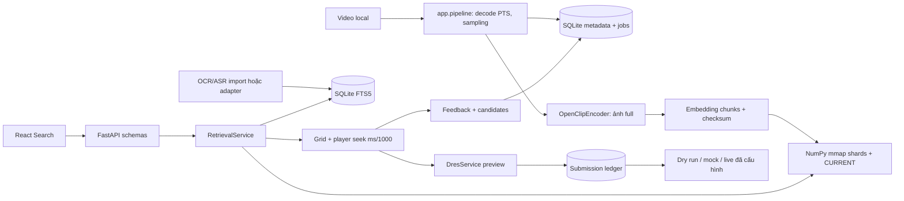

# Kiến trúc đã triển khai

`app/config.py` tập trung cấu hình server. `app/db.py` sở hữu migration schema v1, unique constraints, WAL và transaction. `app/pipeline.py` chỉ chạy offline qua CLI; request HTTP không trích cả kho video. `app/encoders.py` nạp model lười, cache theo service/process. `app/index.py` định nghĩa VectorIndex, NumPyShardIndex và FaissIndex tùy chọn. `app/retrieval.py` tạo kết quả chung theo keyframe ID. `app/dres.py` giữ credentials và ledger tại backend. `app/main.py` nối adapter, phục vụ media qua ID và frontend build.

Lựa chọn exact NumPy giảm phụ thuộc hạ tầng, có CPU và kiểm chứng cosine dễ. Vector được mmap và tìm theo block 4096 row; metadata/mapping vẫn nằm RAM, không phải lời hứa RAM không đổi theo số keyframe. Các phiên bản vector bất biến, CURRENT thay bằng os.replace sau kiểm tra đầy đủ. Không có GPU worker thứ hai. FAISS hiện là adapter CPU chưa cài; Milvus chưa tích hợp, không có profile chạy được trong bản này. Không cần Docker/Redis/Elasticsearch để khởi động.

Model, pipeline và UI có thể thay độc lập nhưng model/checkpoint/preprocessing đổi buộc re-encode. Thêm transcript không cần encode lại ảnh. Thay timestamp/keyframe mapping cần dựng lại index; extract và publish nên chạy khi không có buổi thi đang sử dụng cùng data root. Có thể dùng data root staging riêng rồi khởi động server trỏ phiên bản hoàn chỉnh.

SQLite dùng connection riêng mỗi request; FK bật, timeout 30s. DRES reserve key trong transaction trước network call. Vì DRES có thể nhận POST rồi client timeout, trạng thái unknown giữ nguyên và không tự retry. Đây là hệ thống local một máy, chưa là distributed MapReduce.
